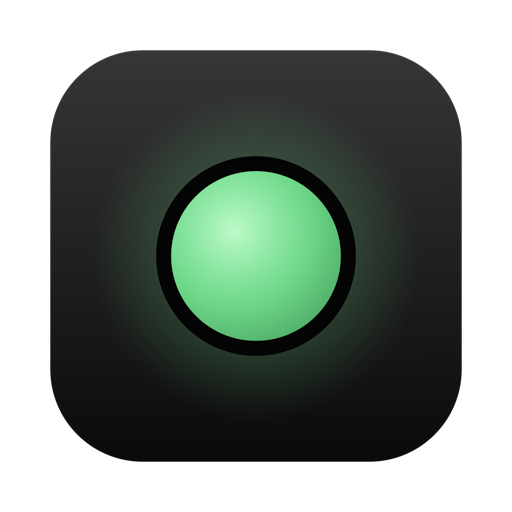
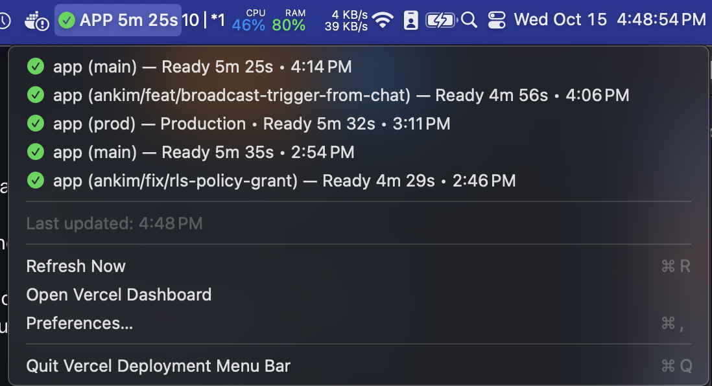

# Deploylight

**Vercel and Cloudflare deploy status in your Mac menu bar.**

Deploylight is a lightweight, open-source **macOS menu bar app** that shows your **deployment status** in real time. It works with **Vercel** deployments and **Cloudflare Workers Builds**. See build/ready/error status at a glance and jump to details with one click.

*Formerly Vercel Deployment Menu Bar.*



**Features**
- Real-time deployment status (build, ready, error)
- Vercel deployments and Cloudflare Workers Builds, merged into one list
- Vercel personal or team tokens
- Team, project, branch, and state filters
- Notarized, code-signed app (no Gatekeeper warnings)
- Native Swift app — lightweight and fast
- Quick access to deployment details from the menu bar

## Installation

### Pre-built Binary (Easiest)

1. Download the latest release from the [Releases](https://github.com/andrewk17/deploylight/releases) page
2. Unzip and move the app to your Applications folder
3. Launch the app
4. Click the menu bar icon and select "Preferences" to add your Vercel and/or Cloudflare API token

### Build from Source

Requirements:
- macOS 13.0 or later
- Xcode 15.0 or later
- Swift 5.9 or later

```bash
# Clone the repository
git clone https://github.com/andrewk17/deploylight.git
cd deploylight

# Build and package as an .app bundle (signed, and notarized if configured)
./Scripts/package-app.sh

# The app will be created at: build/Deploylight.app
```

#### For Developers: Code Signing & Notarization

The app is properly code signed and notarized to prevent macOS Gatekeeper warnings. If you're building for distribution:

1. **Prerequisites:**
   - Apple Developer account ($99/year)
   - Developer ID Application certificate installed
   - App Store Connect API key for notarization

2. **Setup App Store Connect API Key:**
   ```bash
   # Create directory for API key
   mkdir -p ~/.private_keys

   # Download your .p8 file from https://appstoreconnect.apple.com/access/api
   # Move it to ~/.private_keys/

   # Add to ~/.zshrc or ~/.bash_profile:
   export APPLE_API_KEY_ID="your-key-id"
   export APPLE_API_ISSUER="your-issuer-id"
   export APPLE_API_KEY_PATH="$HOME/.private_keys/AuthKey_XXXXXXXXXX.p8"
   ```

3. **Build and notarize:**
   ```bash
   ./Scripts/package-app.sh
   # The script will automatically sign and notarize the app
   ```

The build script will:
- Sign the app with your Developer ID certificate
- Submit to Apple's notary service
- Staple the notarization ticket
- Verify the signature

If notarization credentials aren't configured, the script will still sign the app but skip notarization.

## Configuration

### Step 1 (Optional): Generate a Vercel API Token

1. Go to [Vercel Account Settings → Tokens](https://vercel.com/account/tokens)
2. Click "Create Token"
3. Give your token a name (e.g., "Menu Bar App")
4. Choose the scope:
   - **Personal Account**: Select your personal account scope
   - **Team Account**: Select the specific team you want to monitor
5. Set an expiration date (optional but recommended)
6. Click "Create Token"
7. **Important**: Copy the token immediately - you won't be able to see it again!

### Step 2 (Optional): Generate a Cloudflare API Token

To also show Cloudflare Workers Builds (Workers connected to a git repository in the Cloudflare dashboard):

1. Go to [Cloudflare → My Profile → API Tokens](https://dash.cloudflare.com/profile/api-tokens) and click "Create Token"
2. Choose "Create Custom Token" and add these **Account** permissions:
   - **Workers Builds Configuration: Read**
   - **Workers Scripts: Read**
3. Under Account Resources, include the account(s) you want to monitor
4. Create the token and copy it

It must be a **user** API token (created from your profile). Account-owned tokens can't read Workers Builds.

Workers deployed directly with `wrangler deploy` (from your machine or another CI) don't create builds, so they won't appear.

### Step 3: Configure the App

1. Launch Deploylight from your Applications folder
2. Click the menu bar icon and select "Preferences…"
3. Paste your Vercel and/or Cloudflare token. Changes save automatically.
4. Optionally narrow what's shown:
   - **Team Scopes** and **Projects** (Vercel): all, or specific ones
   - **Accounts** and **Workers** (Cloudflare): all, or specific ones
   - **Filters**: git branches, production/preview, and deployment states
   - **Limits**: a maximum number of deployments, or only the last N hours

The menu bar shows an in-progress build if there is one, otherwise the latest deployment, with its build time. The menu lists recent deployments from both providers, newest first. Click one to open it in Vercel or the Cloudflare dashboard.

## How It Works

The app polls the Vercel deployments API and the Cloudflare Workers Builds API, merges the results, and updates the menu bar icon based on deployment states. It polls faster while a build is running.

Cloudflare polling is kept cheap: each refresh asks for the latest build of up to 20 Workers per request, and a Worker's build history is only re-downloaded when its latest build changes.

## Requirements

- macOS 13.0+
- A Vercel API token and/or a Cloudflare user API token

## License

MIT License - see [LICENSE](LICENSE) file for details

## FAQ

### How do I monitor Vercel or Cloudflare deployments from the macOS menu bar?

Install Deploylight and add your Vercel and/or Cloudflare API token in Preferences. It displays real-time deployment status in your macOS menu bar, polling each provider's API and updating the status icon based on your latest deployments.

### I used Vercel Deployment Menu Bar. Do I need to set things up again?

No. Deploylight is the same app under a new name, and it keeps your existing settings. After installing Deploylight, you can delete the old "Vercel Deployment Menu Bar" app.

### Do I need my Vercel Team ID?

Usually not. Preferences lists the scopes your token can access, so you can pick teams from the list instead of typing IDs.

### How do I fix the "damaged app" error on macOS?

The latest releases (v0.2.0+) are properly code-signed and notarized, so you shouldn't see this error. If you do:

1. Download the latest release from the [Releases](https://github.com/andrewk17/deploylight/releases) page
2. If the error persists, right-click the app and select "Open" instead of double-clicking
3. For older versions, you may need to remove the quarantine attribute: `xattr -d com.apple.quarantine "/Applications/Vercel Deployment Menu Bar.app"`

## Contributing

Contributions are welcome! Please feel free to submit a Pull Request.

---

Deploylight is not affiliated with or endorsed by Vercel Inc. or Cloudflare, Inc. Vercel and Cloudflare are trademarks of their respective owners.
